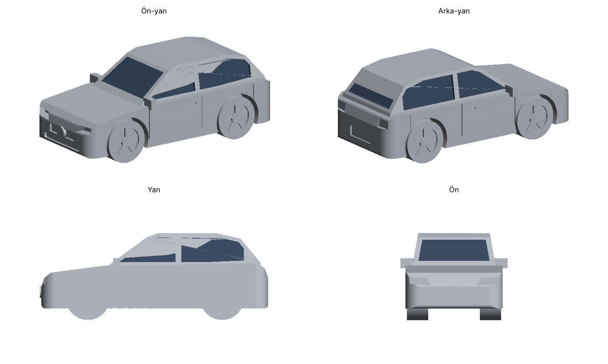
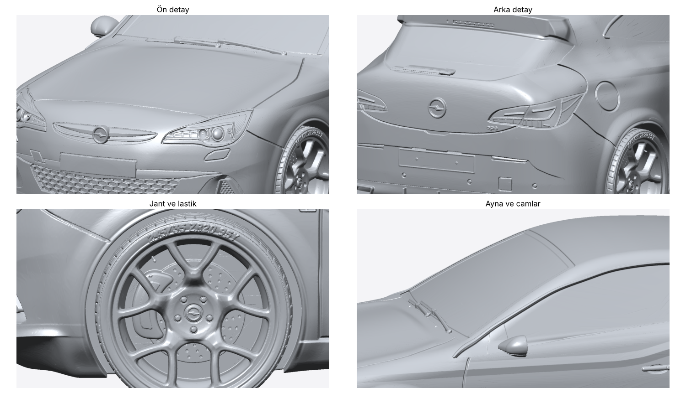

# Opel Astra J GTC (OPC) – 3D Baskı Maketi, 1:24

> **Durum:** Model, aracın **gerçek fotoğraflarıyla eşlenerek** yeniden düzeltildi (bkz. "Fotoğraf eşleme").
> Önceki STL'ler kaldırıldı; bu klasördeki STL'ler fotoğraf eşlemesinden sonra üretilen sürümdür.




Astra J GTC (2011–2018, 3 kapı) OPC donanımlı. Gerçek aracın ölçüleriyle modellenip 1:24 ölçeğe küçültüldü.

| Ölçü | Gerçek araç | Maket (1:24) |
|---|---|---|
| Boy | 4466 mm | 185.2 mm |
| Genişlik (aynasız / aynalı) | 1840 / 2020 mm | 76.5 / 84.0 mm |
| Yükseklik | 1482 mm | ~61 mm |
| Aks mesafesi | 2695 mm | 112.3 mm |
| İz genişliği (ön / arka) | 1584 / 1588 mm | 66 mm |
| Lastik | 245/35 R20 (OPC) | Ø 28.3 mm |

## Dosyalar

| Dosya | Ne için |
|---|---|
| `astra_gtc_tek_parca.zip` | Tekerlekler gövdeye bağlı tek parça; zip içinde `astra_gtc_tek_parca.stl` (118 MB, 2.37 M üçgen, 0.08 mm ızgara) |
| `astra_gtc_govde.stl` | **Kit:** tekerleksiz gövde, alt yüzeyi düz, aks delikli |
| `astra_gtc_teker_on.stl` | **Kit:** ön tekerlek (355 mm disk, Brembo kaliper). **2 adet** basılır |
| `astra_gtc_teker_arka.stl` | **Kit:** arka tekerlek (315 mm disk, tek pistonlu kaliper). **2 adet** basılır |
| `astra_gtc_olustur.py` | Tüm STL'leri üreten betik (ölçek ve çözünürlük ayarlanabilir) |

Tüm dosyalar su geçirmez (manifold) ve tek gövdedir; dilimleyicide onarım gerekmez.
Kit gövde ve teker **0.07 mm**, tek parça **0.08 mm** ızgarada çıkarıldı; sadeleştirmede en fazla 0.005 mm sapma var.

## Modeldeki detaylar

- **Ön:**
  - kanat şeklindeki krom çıta ve ortasında **Opel şimşekli rozet**
  - iki yatay çıtalı üst ızgara
  - bumerang farlar: gündüz farı çizgisi, iki projektör merceği, çamurluğa sarılan yan kısım
  - kaput ortasındaki sırt ve kaput kapağı çizgisi
  - plaka yeri
  - **bal peteği ağlı** büyük alt ızgara
  - petek ağlı köşe hava girişleri ve çevrelerindeki "bıçak" kanatları
  - splitter dudağı
- **Yan:**
  - GTC'ye özgü, kapının önünden arka çamurluğa yükselen **"bıçak" çizgisi**
  - omuz çizgisi
  - geniş arka çamurluk kabarıklıkları
  - OPC marşpiyel
  - kapı aralıkları ve kapı kolu
  - sağ arkada yakıt kapağı
  - ön kapı camı, B direği ve sivri biten arka yan cam
  - sinyal çizgili, damla biçimli aynalar ve üçgen cam önündeki siyah panel
- **Üst:**
  - girintili ön ve arka camlar
  - park konumunda iki silecek
  - köpekbalığı anten
  - OPC tavan spoyleri
- **Arka:**
  - kanat grafikli, yana sarılan stoplar
  - aralarındaki krom şerit ve **Opel şimşekli rozet**
  - sağ stobun altında kabartma **"opc" rozeti**
  - bagaj kapağı çizgisi ve plaka yeri (plakasız seçenekte yuvada kabartma **"GTC"**)
  - kanatçıklı difüzör
  - **çift trapez egzoz** çıkışı
  - reflektörler
- **Tekerlek:**
  - 20 inç, 5 çift kollu jant (V biçimli boşluklar), bijonlar ve göbek kapağı
  - önde **355 mm delikli disk** ve Brembo kaliper, arkada **315 mm ince delikli disk** ve tek pistonlu kaliper
  - diş kanalları olan lastik

Ön ve arka rozetlerde Opel şimşeği kabartma olarak işlendi: halka 0.4 mm, şimşek rozet zemininden 0.3 mm yüksek.
Arkada, fotoğraflardaki yerinde (sağ stobun iç ucunun altında, bagaj kapağı çizgisinin hemen üstünde) kabartma "opc"
rozeti var: ~3 mm genişlik, 0.27 mm çizgi, 0.3 mm yükseklik. Gerçek araçta plaka yuvasının tabanında kabartma italik "GTC"
yazısı bulunur; plaka takılıyken görünmez, `--plakasiz` ile üretilen sürümde plaka yerine bu yazı ve iki vida deliği çıkar.
OPC arka kapağında ASTRA yazısı yoktur; başka yazı eklenmedi.

> Opel adı ve şimşek logosu Opel Automobile GmbH / Stellantis'in tescilli markasıdır. Logolu maket kişisel kullanım ve kâr amacı gütmeyen sergileme içindir; satış veya ticari kullanım için marka sahibinden izin gerekir.

## Hangi sürümü basmalı?

**Kit önerilir.** Tekerlekler jant yüzü yukarı bakacak şekilde basılınca kollar, bijonlar ve disk delikleri çok daha net çıkar. Gövde de alt yüzeyi tablaya oturduğu için neredeyse desteksiz basılır.

### Kit montajı

1. Gövdeyi, 2 ön ve 2 arka tekerleği basın (`_teker_on` ve `_teker_arka`; arka freni küçük olandır).
2. **1.75 mm filamentten 2 parça aks** kesin, her biri yaklaşık **62 mm**.
3. Aksı gövdedeki delikten geçirin (Ø 2.1 mm, aks serbest döner).
4. Ön tekerlekleri ön aksa, arka tekerlekleri arka aksa bastırın. Tekerlekteki kör delik Ø 1.8 mm olduğu için sıkı geçer; gevşekse bir damla japon yapıştırıcısı yeterli.

Tekerlekler döner.

## Baskı ayarları

### FDM (filamentli)
| Ayar | Gövde | Tekerlek |
|---|---|---|
| Nozul | **0.2 mm** (en iyi) / 0.4 mm | **0.2 mm** önerilir |
| Katman | 0.06–0.08 mm | 0.05–0.08 mm |
| Çevre | 3–4 | 3 |
| Doluluk | %15 gyroid | %30 |
| Hız | Dış duvar 25–30 mm/s | 20 mm/s |
| Destek | Ağaç destek, **yalnız tabladan**: aynaların altı ve spoyler ucu | Gerekmez |
| Yönelim | Alt yüzey tablada | Jant yüzü yukarı, arka yüz tablada |

- **0.4 mm nozulda:** bal peteği ağı, disk delikleri ve kapı aralıkları yumuşar ama görünür kalır. Bu detaylar için 0.2 mm nozul ya da reçine yazıcı fark yaratır.
- **"Arachne" duvar üretecini** (Cura/Prusa/Orca'da varsayılan) açık tutun; ince çıtaları daha iyi basar.
- **Tek parça sürüm:** tekerleklerin altındaki 0.25 mm düzlük tablaya oturur. Gövdenin altı tabladan ~4.7 mm yüksekte olduğundan **"yalnız tabladan" destek** gerekir.

### Reçine (MSLA) — en detaylı sonuç
- Katman 0.03–0.05 mm.
- Gövdeyi dilimleyicide **2 mm et kalınlığıyla oyun**, iç tarafa 2 adet Ø3 mm tahliye deliği açın.
- Arkası aşağıda, 30–45° eğik yerleştirip hafif destek kullanın.
- Tekerlekleri arka yüzleri tabla tarafında düz basabilirsiniz.

## Boyama önerisi
1. **Astar:** Gri astar, 400 ve 800 zımpara.
2. **Gövde ve tavan:** Gövde rengi; OPC için çoğunlukla mavi, beyaz ya da kırmızı. Tavan siyah da olabilir.
3. **Siyah kısımlar:** Cam girintileri parlak siyah. Bal peteği ızgaralar, köşe girişleri, difüzör ve B direği mat siyah.
4. **Krom kısımlar:** Kanat çıtası, rozet halkaları ve şimşekler, arka krom şerit ve egzoz uçları krom/gümüş kalem. Rozet zeminini siyaha boyayıp şimşeği ve halkayı kromla boyarsanız logo çok net okunur.
5. **Lambalar:** Farlar gümüş, üzerine şeffaf vernik. Stoplar şeffaf kırmızı.
6. **Tekerlekler:** Lastikler mat siyah. Ön kaliperler kırmızı ya da sarı (OPC'de Brembo); arka tek pistonlu kaliperler siyah/koyu gri, logosuz.
   "opc" rozeti krom ya da mavi krom, plakasız yuvadaki "GTC" gövde rengi.
7. **Vernik:** En son parlak vernik.

## Yeniden üretmek / ölçek değiştirmek

```bash
pip install numpy scipy scikit-image trimesh manifold3d
python3 astra_gtc_olustur.py --h 0.10        # sergi kalitesi, 1:24 (~5 dk)
python3 astra_gtc_olustur.py                 # 0.15 mm ızgara, daha hızlı
python3 astra_gtc_olustur.py --olcek 18      # 1:18 (~248 mm)
python3 astra_gtc_olustur.py --plakasiz      # plakasız arka: yuvada kabartma "GTC"
```

Aks delikleri baskı ölçüsünde sabittir (1.75 mm filament), ölçek değişse de aynı kalır.
1:18'de aks boyu ≈ 62 × 24 / 18 ≈ 83 mm olur.

## Denetim süreci

Model iki tur boyunca üç ayrı denetçi ajan tarafından incelendi: ön yüz, yan profil ve arka/üst görünüş.
Her tur standart açılardan görüntü alındı. Ajanlar bunları gerçek Astra J GTC ile karşılaştırıp milimetre cinsinden düzeltmeler önerdi ve her düzeltmeyi ayrı bir kopyada deneyerek doğruladı.

- **Oranlar ve kabin:**
  - Genişlik 1836 mm'ye indirildi.
  - Kabin üstten bakınca daralıyor, arka çamurluk üstlerinde basamak oluşuyor.
  - C direği içe yatıyor.
  - Kapı ile cam arasında yaklaşık 50 mm'lik omuz basamağı var.
- **Yan:**
  - GTC'ye özgü, arkaya sivrilen yan cam.
  - Keskin kenarı üstte olan "bıçak" çizgisi.
  - Kapı kolu omuz çizgisinin üzerinde.
- **Ön:**
  - Kaputun altına giren büyük bumerang farlar.
  - İnce, sivri kaput sırtı.
  - Gülümseme şeklinde petek ızgara.
  - Bumerang şeklinde köşe hava girişleri.
  - Gerçek boyutta rozet halkası.
  - Düz üstlü, ince kollu aynalar.
- **Arka:**
  - Dik arka kapak ve küçük "ördek kuyruğu".
  - Daha yatık ve uzun arka cam.
  - Tavanın devamı gibi duran spoyler.
  - Kanat şeklinde stoplar ve gövdeyle uyumlu bagaj kapağı çizgisi.
  - OPC difüzörü ve köşe hava girişleri.

## Detay turu (farlar, arka, jant, amblem)

- **Farlar:**
  - derin yuva ve siyah çerçeve
  - krom halkalı kubbeli projektör merceği
  - ayrı uzun far çanağı
  - kaş biçimli LED gündüz farı şeridi
  - kaburgalı üst reflektör ve sinyal üçgeni
  - çok bölmeli iç reflektör
- **Opel amblemi:** pahlı taban, çukur zemin, kubbeli halka, pahlı ve sırtlı şimşek. Ön ve arkada aynı.
- **Arka:**
  - kırışıksız, fotoğraf siluetlerine oturan arka gövde
  - lens, krom bıçak, LED çubuk ve kanat, geri vites ve sinyal bölmeli stoplar
  - plaka çerçevesi ve vidaları
  - reflektörler ve park sensörleri
  - kanatçıklı difüzör ve 3.4 mm derin trapez egzozlar
  - LED noktalı üçüncü stop ve arka silecek
- **Jant ve lastik:**
  - OPC 20 inç, 5 çatallı Y kol, derin içbükey yüz
  - cıvatalar ve rozetli göbek kapağı
  - önde 355 mm delikli/havalandırmalı disk ve logolu Brembo kaliper
  - arkada 315 mm ince delikli disk, tek pistonlu yüzer kaliper (kılavuz pimleri, braket)
  - "245/35 ZR20 95Y" yanak yazısı ve diş deseni
- **Çamurluklar:** kıvrık dudak

## Fotoğraf eşleme

Model, Astra J GTC / OPC'nin açık lisanslı **19 gerçek fotoğrafına** göre düzeltildi. Kaynaklar Wikimedia Commons ve Flickr.
Üç ajan, her fotoğraf için bir kamera çözdü. Kamera, bilinen noktalara oturtuldu: teker merkezleri (aks mesafesi 2695 mm, iz 1584/1588 mm), lastik temas noktaları, ön cam köşeleri, plaka ve rozet.
Ajanlar modeli bu kameralardan çizip fotoğrafın üzerine bindirdi ve farkları milimetre olarak ölçerek düzeltti. Tipik hata payı ±20–40 mm (1:24'te ~1–1.5 mm).

- **Yan:**
  - GTC "bıçak" çizgisi: kapının önünden kıvrılıp ~600 mm'de ilerler.
  - B direğinden sonra arka çamurluğa yükselen omuz çizgisi.
  - Kapı 80–100 mm öne alındı.
  - Arkaya sivrilen uzun yan cam ve krom cam çerçevesi.
  - Gerçek jant çapı (ince lastik yanağı).
  - Yükseltilmiş marşpiyel, yeni ayna ve kapı kolu konumu.
- **Ön:**
  - Fotoğraftan ölçülen bumerang farlar: projektör, gündüz farı ve iç bölmeler.
  - Gerçek genişlikte üst ızgara ve kalın krom kanat çıtası.
  - Yarı yüksekliğe inen, yatay petek dokulu alt ızgara.
  - Gümüş "onay işareti" bıçaklı üçgen köşe girişleri.
  - Siyah tampon şeridi ve doğru yükseklikte kaput çizgisi.
  - Far yıkama kapağı ve çeki kancası kapağı.
- **Arka:**
  - Tampona uzanıp yandan öne sivrilen bumerang stoplar.
  - Daralan kuyruk.
  - Tampona taşınan plaka.
  - Bagaj kapağının "gülümseme" çizgisi.
  - Gerçek konum ve boyutta rozet.
  - İki yanda tek trapez egzozlu OPC difüzörü.
  - Uç plakalı büyük spoyler ve üçüncü stop; spoyler uçları D direğinin ~40 mm dışına taşar.
  - D direği beli ve stop üstü yuvarlak omuz: üç kalibre fotoğrafın (beyaz OPC tam arka, siyah ve mavi OPC arka
    çapraz) siluetlerinden; üst yan yüzey z 1040–1200'de 20–45 mm içeri çekildi.
  - Difüzör kanatlarının alt kenarı fotoğraftaki difüzör alt hattına (z ≈ 200) çekildi.
  - Fotoğraftaki yerinde "opc" rozeti, plakasız yuvada "GTC".
  - Arka silecek, reflektörler ve park sensörleri.

### Bağlantı noktaları turu

Bu turda dört ajan ayrı bölgeleri inceledi: kapılar/yan, arka, ön ve jant. Bir denetçi ajan da modeli fotoğraflarla
karşılaştırıp 12 bulgu çıkardı; hepsi düzeltildi. Odak, parçaların birleştiği yerlerdeki kaymalardı.

- **Kapılar ve yan:**
  - Kapı, cam ve marşpiyel çizgilerinin birleşim yerleri hizalandı; kapının arka-alt köşesindeki kopuk parçalar giderildi.
  - Kapı camının alt çizgisi önde 60–80 mm indirildi.
  - Üçgen cam büyütüldü. Ön direk kromu fotoğraftaki gibi öne ve aşağı uzanıyor.
  - Üçgen camla kapı camı arasında, cam hizasında geniş siyah panel var.
  - Ayna, uzun bir damla biçiminde: ön ucu basık, camı D biçimli.
  - C direğindeki çukur düzeltildi.
  - Kapı kilidi yalnız sürücü (sol) kapısında.
- **Arka:**
  - Spoyler uç plakası, öne bakan üçgen bir kanatçık olarak D direğine temiz oturuyor (eski buruşukluk giderildi).
  - Tamponda kırım çizgisi, plaka yuvası (üstte 300 mm, altta 352 mm genişlikte trapez) ve stop alt kenarı fotoğraflara göre düzeltildi.
- **Ön:**
  - Alt dudak, fotoğraftan ölçülen hatta çekildi.
  - Far oluğu ve reflektörü, far yıkama kapağı, kaput kenarı ve çamurluk sırtı düzeltildi.
- **Jant:**
  - Kollar, gerçek janttaki gibi r≈97'de kapanan V biçimli boşluklar, daralan gövde ve hafif kavisli çatallarla yeniden çizildi.

Silecekler soldan direksiyonlu (Avrupa/Türkiye) araca göre park konumunda.

### Stop, bagaj ve ön derz turu

- **Ön tampon–çamurluk derzi:**
  - Eskiden farın arka üst ucundan başlıyordu, fotoğraftaki yerinin 90–120 mm üstünde ve arkasındaydı.
  - Artık iki fotoğrafın ortalamasına göre farın dış alt köşesinden teker kemerine iniyor ve far oluğuna boşluksuz bağlanıyor.
  - Kaput–çamurluk hattı x 900–1100 arasında 4–11 mm düzeltildi.
- **A direği kromu:** Alt ucundaki S kıvrımı giderildi; çapraz bakışta tek yönlü, düzgün bir eğri çiziyor.
- **Ayna:** Kapağın üstü, ön çapraz ve siyah OPC fotoğraflarına göre 35 mm indirildi. Gri yan fotoğraf bu bölgede diğer ikisiyle çelişiyordu; ona göre ayar yapılmadı.
- **Yakıt kapağı:** Oluk, yuvarlak dipli ve kenarı yumuşatılmış analitik bir yiv oldu; testere dişi kalmadı.
- **Arka stoplar:** Beyaz OPC tam arka ve gri GTC fotoğraflarına göre yeniden çizildi.
  - Üst kenarın içten dışa yükselişi 79 mm'den ~45 mm'ye indi; lamba daha yatık ve ~30 mm daha uzun.
  - İç uç fotoğraftaki gibi yuvarlak küt.
  - Dış uç sivri (~33°).
- **Bagaj kapağı:** Ortasındaki 15 mm'lik eğim kırığı (yatay basamak) giderildi; yüzey cam altından tampona kesintisiz iniyor.
- **Amblem:** Halka merkezi fotoğraftaki yerine indi (23 mm).
- **Ağ temizliği:** Sadeleştirmenin bıraktığı ters dönmüş ince üçgenler (dilimleyicide çizik gibi görünür) kenar çevirmeyle düzeltiliyor; geometri değişmiyor.

### Fotoğraf kaynakları (teşekkürler)

Fotoğraflar yalnızca ölçü referansı olarak kullanıldı; depoya eklenmedi.

| Fotoğraf | Sahibi | Lisans | Kaynak |
|---|---|---|---|
| 2013 Opel Astra (12261340845) | 30474136@N07 | CC BY 2.0 | https://commons.wikimedia.org/wiki/File:2013_Opel_Astra_%2812261340845%29.jpg |
| 2013 Opel Astra GTC (12261340885) | 30474136@N07 | CC BY 2.0 | https://commons.wikimedia.org/wiki/File:2013_Opel_Astra_GTC_%2812261340885%29.jpg |
| 2013 Opel Astra GTC (12261340895) | 30474136@N07 | CC BY 2.0 | https://commons.wikimedia.org/wiki/File:2013_Opel_Astra_GTC_%2812261340895%29.jpg |
| Opel Astra GTC (6146441113, 6146441495, 6146990208, 6146991152) | Autoviva | CC BY 2.0 | https://commons.wikimedia.org/wiki/Category:Opel_Astra_J_GTC |
| Opel Astra GTC 1.6T Enjoy/Sport 2014–2015 (14208949925, 15542168768, 15736712516, 54188905081) | juanelo242a | CC BY-SA 2.0 | https://commons.wikimedia.org/wiki/Category:Opel_Astra_J_GTC |
| Opel Astra GTC OPC 2013/2015 (8366545858, 17022087756, 34848925543) | juanelo242a | CC BY-SA 2.0 | https://commons.wikimedia.org/wiki/Category:Opel_Astra_J_OPC |
| 2012–2013 Opel Astra (AS) OPC 3-door hatchback (15922355098, 15924017627, 26608054501, 26608068581) | car_spots_aus | Commons sayfasına bakınız | https://commons.wikimedia.org/wiki/Category:Opel_Astra_J_OPC |
| Opel Astra OPC (8080939836) | 8058098@N07 | CC BY 2.0 | https://commons.wikimedia.org/wiki/File:Opel_Astra_OPC_%288080939836%29.jpg |

## Kaynak ve doğruluk

- **Kaynak:** Gövde oranları üretici verilerine dayanır: boy, genişlik, yükseklik, aks mesafesi, iz genişliği, yerden yükseklik ve lastik ölçüsü.
- **Yaklaşık kısımlar:** Teknik çizim (blueprint) indirilemedi. Bu yüzden şunlar aracın bilinen tasarımı ve referans fotoğrafı esas alınarak modellendi:
  - yüzey kıvrımları,
  - cam ve far çizgileri,
  - tampon şekilleri.
- **Daha doğru sonuç için:** Ölçü kontrolü yapmak isterseniz `astra_gtc_olustur.py` içindeki profil tabloları (`Z_ALT_UST`, `Z_KABIN`, `ON_PLAN` …) gerçek milimetre cinsindendir. Bir teknik çizimle karşılaştırıp düzeltmek kolaydır.
